# RehabFlow

**Rehab that goes home with you.** RehabFlow is an AI-agent powered rehabilitation
platform: safe AI triage, guided daily exercise with real-time movement feedback,
and real professionals who can see how you are doing, all organised around one
Care Episode per rehabilitation concern.

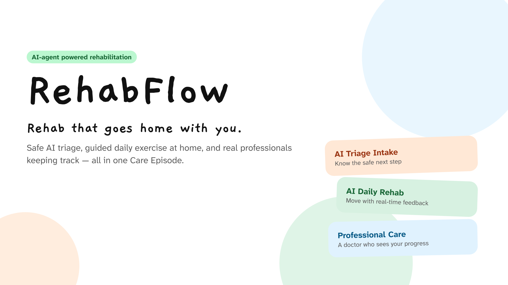

## Initial problems: serious gaps between rehabilitation demand and resources

**The demand for rehabilitation is enormous.** About **2.4 billion people** live with a condition that
may benefit from rehabilitation ([WHO](https://www.who.int/news-room/fact-sheets/detail/rehabilitation)).
The Global Burden of Disease estimate is 2.41 billion in 2019, up 63% since 1990.
**1.71 billion** of those (about 71%) are musculoskeletal, and low back pain alone
affects 568 million ([Cieza et al., *The Lancet* 2020](https://pubmed.ncbi.nlm.nih.gov/33275908/)).
"Need" means people who may benefit at some point, not everyone at once.

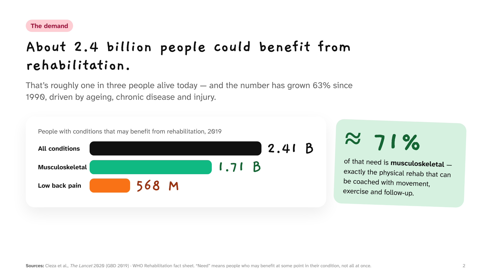

**The supply is thin and unevenly spread.**

- Rehabilitation workforce density ranges from under 0.01 to about 25 per 10,000
  people across reporting countries
  ([workforce review, 2017](https://link.springer.com/doi/10.1186/s12960-017-0182-7)).
  WHO reports fewer than 10 skilled practitioners per million people in many
  low- and middle-income settings.
- In some low- and middle-income countries, **more than half** of the people who
  need rehabilitation do not receive it ([WHO](https://www.who.int/news-room/fact-sheets/detail/rehabilitation)).
- Geography matters even in rich countries. US rural areas have roughly half the
  physical therapists per 10,000 residents of urban areas
  ([HRSA data via Univ. of Kentucky](https://medicine.uky.edu/sites/default/files/inline-files/2024%20Kentucky%20Physical%20Therapy%20Workforce%20Report.pdf)),
  and availability clusters locally rather than following a clean urban/rural
  line ([JMIR Formative Research, 2025](https://formative.jmir.org/2025/1/e85025)).

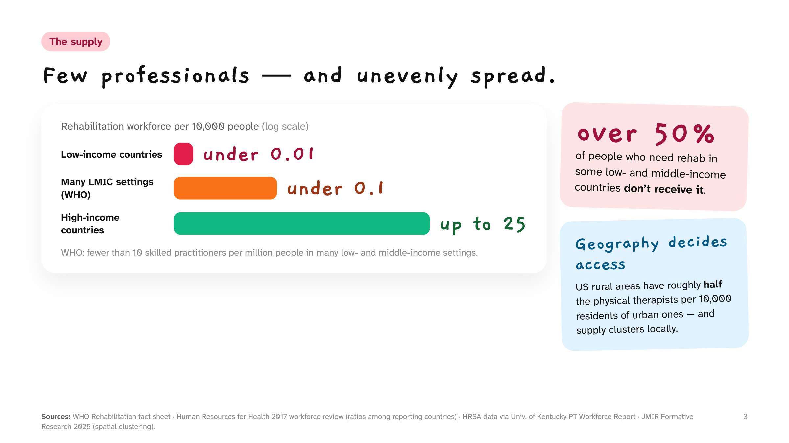

**The price adds a second barrier.** Typical US uninsured prices are **$75-350 per
session** (about $150 is commonly quoted). A 6-12 week course at 2-3 visits a week is
quoted at **$500-4,000+**, and in-home visits run **$100-350**. These are directional
figures from clinic and price-comparison guides, not claims data
([example](https://www.orthobethesda.com/blog/how-much-does-physical-therapy-cost/),
[example](https://valuepenguin.com/physical-therapy-cost-health-insurance)).
Insured co-pays are usually far lower.

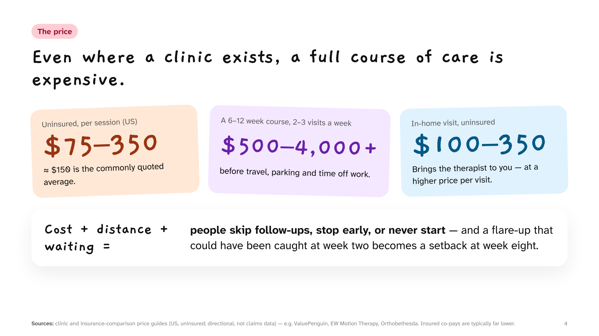

### The missing layer: daily rehab at home, with professionals tracking online

A week has 168 hours. Even three one-hour clinic visits only cover about **2%** of it. The
other ~98% is where recovery actually happens, usually alone and without feedback.

- Adherence to physio-prescribed home exercise can be as low as **50%**
  ([review of RCTs](https://pmc.ncbi.nlm.nih.gov/articles/PMC9527092), citing Argent
  et al.). Some reviews of unsupervised programmes report non-adherence up to 70%.
- Telerehabilitation gives **comparable outcomes** to in-person care for
  musculoskeletal problems, with fewer clinic visits and less travel
  ([meta-analysis](https://www.ncbi.nlm.nih.gov/pmc/articles/PMC11911901/),
  [umbrella review](https://pubmed.ncbi.nlm.nih.gov/38306156/); most included
  reviews were rated low quality, so treat this as encouraging, not settled).

The opportunity is **daily domestic and community rehabilitation, with professionals
keeping track of patients online**, not one more waiting list. That is what RehabFlow
builds.

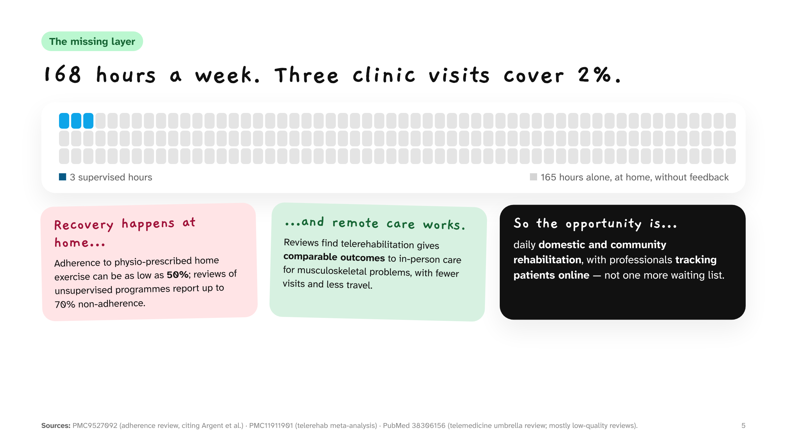

## RehabFlow: one loop, one Care Episode

A **Care Episode** keeps one rehabilitation concern's AI Triage Intake,
recommendations, memory, daily rehab, Professional Care activity, history, and next
steps together, so a back problem never gets mixed with a sore shoulder.


### 1. AI Triage Intake: an AI you can trust to know when to stop

Gathers symptoms, goals, rehabilitation context, and warning signs, then recommends
the next step, including suitable exercises when the patient is ready for self-care.
Saved **Triage Summaries** record the concern, safety context, open questions and next
step, and provide the durable context for later episode workflows.

Trust is designed in:

- **Emergencies stop the plan.** If the router detects a red-flag emergency, RehabFlow
  gives no rehab plan. It tells the patient to get medical care now. A professional
  doctor is available on the same platform through **Professional Care**.
- **Reliable search and references.** Web evidence comes from an allow-list (NIH, CDC,
  NHS, Mayo Clinic, MedlinePlus, Cleveland Clinic, Johns Hopkins, HSS, AAOS). A
  **Grounding Reviewer** checks claims against retrieved sources and a **Safety
  Reviewer** checks for unsafe guidance. If an answer cannot be supported, it is
  withheld and the patient is pointed to a licensed professional.
- **Clarification and resume.** When information is missing, the patient sees a clear
  follow-up question and can continue the same AI session after answering.
- **Exercise recommendations use RAG over a professional local knowledge base.**
  Suggestions come from a curated catalog of 1,622 exercises (instructions,
  conditions, body structures, reference video), not from text the model invents.
  The patient reviews them before anything becomes an active session.
- **Rehab Safety Gate.** Exercise guidance starts only after AI triage or
  clinician-reviewed context.

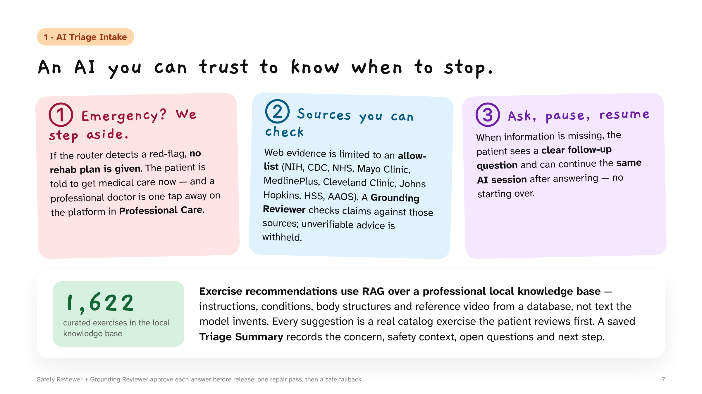
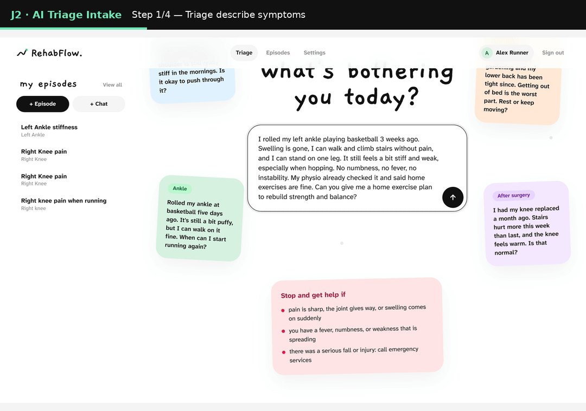

### 2. Professional Care: your doctor, around one Care Episode, by consent

Connect a patient and a selected doctor around one Care Episode, with a **Care
Conversation**, care plans, an **AI Care Summary**, and optional live movement
monitoring.

1. The patient opts in to the Professional Care subscription.
2. The patient finds a doctor through semantic search and expertise tags in the Doctor
   Selection Queue.
3. The patient sends a **Care Connection Request**; the doctor accepts.
4. The patient selects one accepted doctor, which creates the **Care Relationship**.

Search ranks fit but never auto-assigns a doctor, and a Care Episode has at most one
selected doctor at a time.

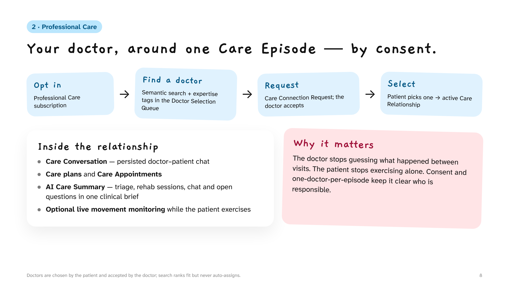 
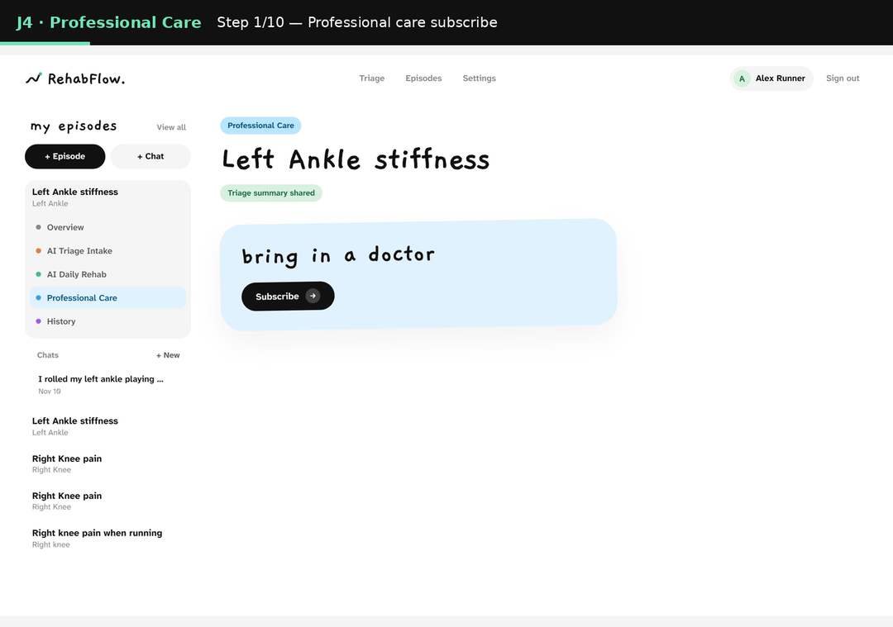

### 3. AI Daily Rehab: see your movement, not just hear about it

Turn reviewed, triage-based recommendations into an episode-specific **AI Daily Rehab
List**. Browse the database-backed **Exercise Catalog**, inspect instructions and
reference media, start guided sessions, mark exercises complete, add notes, and review
rehab history. During a session the browser runs pose detection on your camera, the
reference exercise video can carry a pose overlay, and a live movement score is
streamed to the doctor you are linked to.

> *"Visual feedback in rehab is very important, because some patients cannot feel the
> body part as normal people do."*
> **Insights from rehab experts**

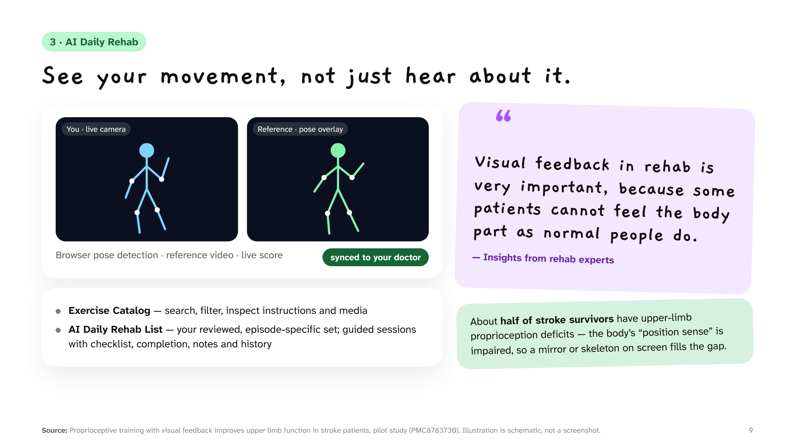
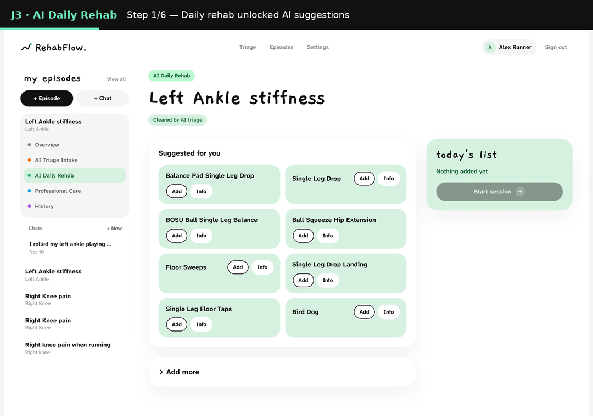

### 4. Patient and doctor workspaces

- **Patients** get the Patient Dashboard (active and past episodes, recent rehab,
  Professional Care status), the Episode Dashboard and Care Episode Brief, and
  **memory they control**: review and edit what the AI remembers, and choose what
  doctors can see.
- **Doctors** work from the **Care Worklist** (incoming requests, active
  relationships) and the **Doctor Dashboard**, with a Patient Panel Briefing and an
  Attention Map that show who needs attention and what changed. Briefings are
  doctor-private and never alter the patient record.

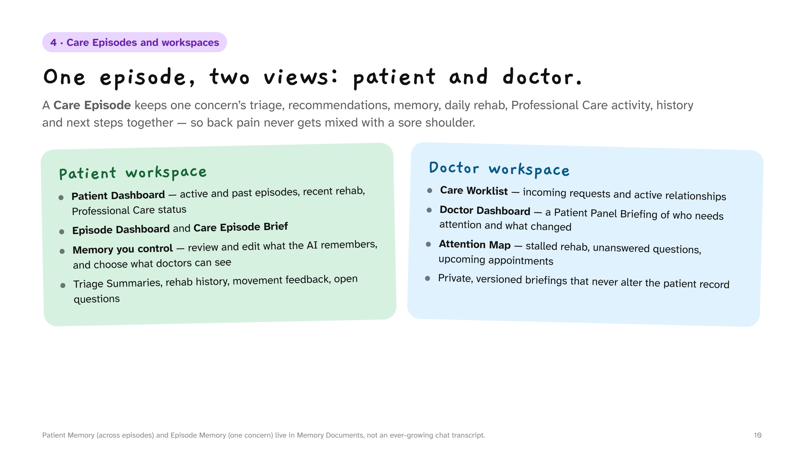 
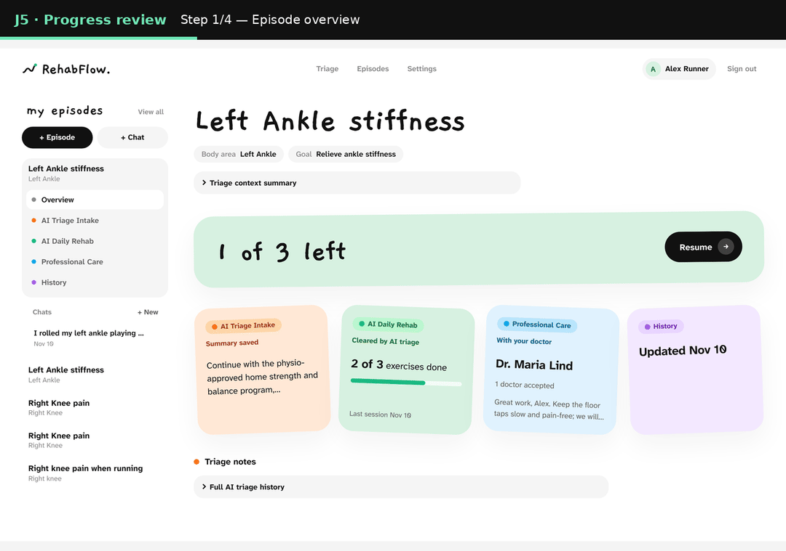

## Why it matters

| | |
|---|---|
| **Patients** | Start safely today from home, with lower travel and visit cost and fewer abandoned programmes. |
| **Clinicians** | Review a panel through briefings and attention signals, and spend visit time where it changes outcomes. |
| **Health systems** | Continuity between visits, earlier escalation of flare-ups, and a data trail for adherence and progress. |

Triage and guided daily rehab are the self-care front door. **Professional Care** is a
patient opt-in tier (a one-click state in the MVP; payment is future work). The moat is
trust: safety gating, allow-listed sources and reviewer agents.

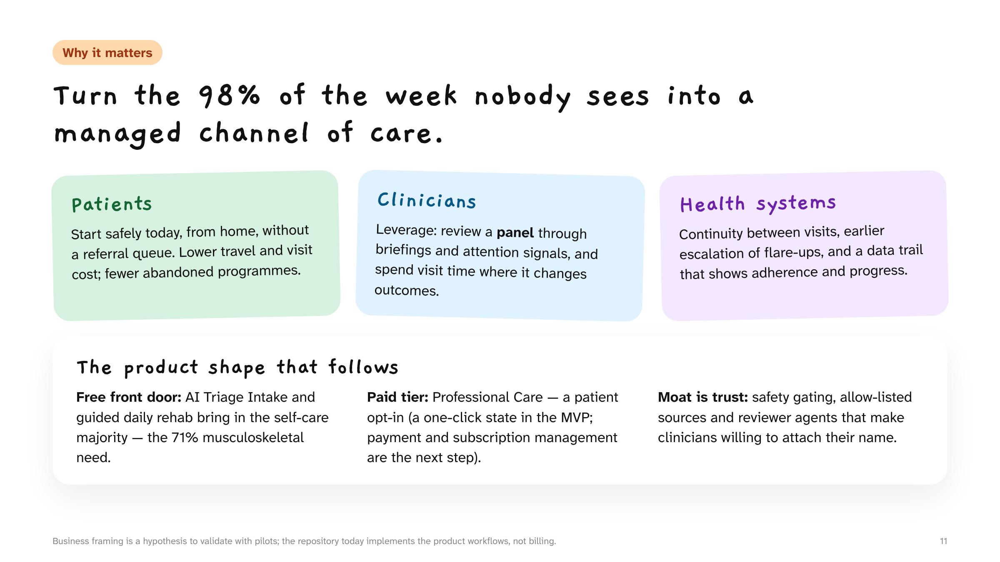

## Built to be checked

Specialised agents each have one job: Router, Consultant, Safety Reviewer, Grounding
Reviewer, and the Memory and Session Compaction agents. A reviewer disagreement
triggers one repair pass, then re-review, then a safe fallback. The service-backed
evaluation corpus has 44 cases. See [Engineering highlights](docs/engineering-highlights.md)
and [backend/evals/README.md](backend/evals/README.md).


## Quick start

After installing Docker and configuring provider credentials in `.env`, start the complete stack with one command:

```bash
./start-dev.sh
```

The launcher runs the PostgreSQL, Redis, Qdrant, FastAPI, and Product services through Docker Compose. It uses rootless Docker when the active context provides it. On networks where Docker Hub is unavailable, set `IMAGE_REGISTRY=docker.m.daocloud.io` before the command.

### No-Docker startup with Apptainer

On CSC hosts where Docker is unavailable, start the same development stack with:

```bash
./start-dev-apptainer.sh
```

This runs PostgreSQL, Redis, and Qdrant through Apptainer and runs FastAPI and
Product from the checked-out Python and Node dependencies. The first run pulls
the container images through Apptainer. Runtime data defaults to
`/scratch/project_2020551/rehabflow-runtime` when that path is writable, or to
`.rehabflow-runtime` in the repository otherwise. The default Product and API
ports are 3000 and 8001. Ports are set on the start command, not in `.env`:

```bash
./start-dev-apptainer.sh --product-port 3005 --backend-port 8005
```

`--postgres-port`, `--redis-port`, `--qdrant-port` and `--qdrant-grpc-port`
work the same way, and `./start-dev.sh` (Docker) takes the same options.
`shutdown` and `restart` reuse the ports of the last start unless you pass new
ones. The launcher stays in the foreground and reuses a service that is already
running on its chosen port.

RehabFlow needs Python 3.10+, Node.js 20+, PostgreSQL, Redis, and either Qdrant
or an explicitly configured embedded Qdrant path.

```bash
cp .env.example .env
python3.11 -m venv backend/.venv
backend/.venv/bin/python -m pip install -r requirements.txt
npm ci
```

Configure the provider, database, checkpoint, Redis, Qdrant, JWT, and trace
settings in `.env`, apply the application and LangGraph checkpoint schemas,
then start the API and Product app:

```bash
cd backend
.venv/bin/alembic -c ../alembic.ini upgrade head
.venv/bin/python scripts/setup_langgraph_checkpoints.py
PYTHONPATH=. .venv/bin/python -m uvicorn app.main:app --host 127.0.0.1 --port 8000
# In another shell, from the repository root:
npm run dev:product
```

Open <http://localhost:3000>. The API health endpoints are
<http://127.0.0.1:8000/health> and
<http://127.0.0.1:8000/ai/chat/health>.

For a one-command developer startup after the one-time dependency setup above,
run:

```bash
./start-dev.sh
```

The launcher starts PostgreSQL, Redis, and Qdrant with Docker Compose, applies
database migrations, initializes LangGraph checkpoints, and runs the API and
Product app. It first tries the current Docker context;
if the Docker socket requires elevated access, it uses your normal `sudo`
credential for Docker only. No permanent `docker` group change is required.

See [backend/README.md](backend/README.md) for required environment variables,
service ports, authentication, migrations, health probes, persistent
`systemctl --user` services, and evaluator usage.

## Repository layout

- `apps/product`: patient and doctor product application
- `apps/console`: internal QA console
- `packages/shared`: shared browser API/auth/runtime helpers
- `backend/app`: FastAPI, LangGraph runtime, persistence, and services
- `backend/evals`: offline and service-backed agent evaluations
- `docs/`: documentations

Docker Compose remains useful for local infrastructure. Complete application
image packaging, registry publishing, and production container deployment are
future production work.
